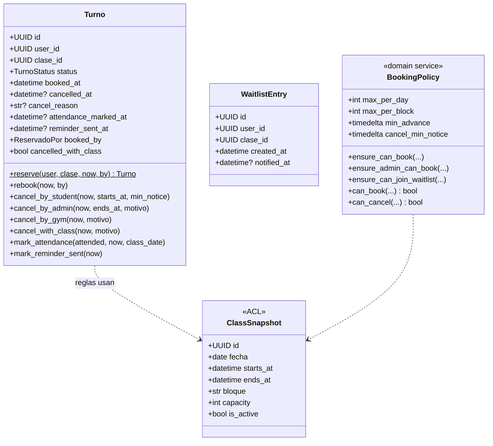
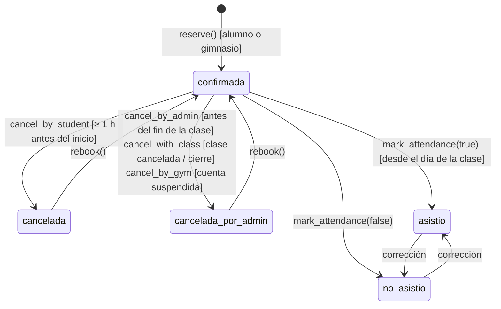
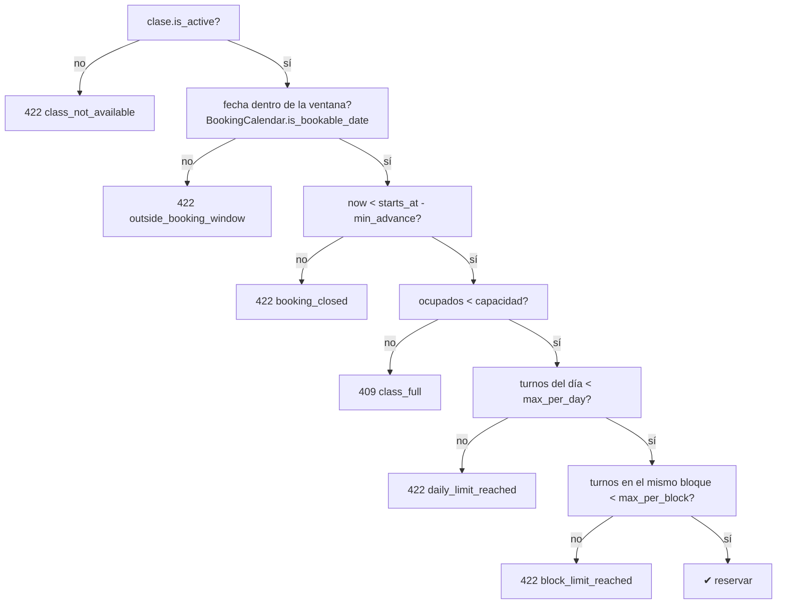
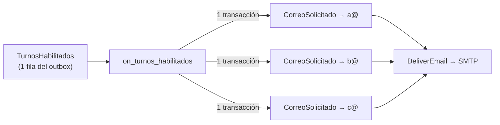

# Pilates Studio: Contextos `booking` y `notifications`

> [Documentación técnica](TECH.md) · [Contextos `identity` y `scheduling`](identity-scheduling.md) · **Contextos `booking` y `notifications`** · [Calendario de reservas y flujos principales](flujos.md) · [Concurrencia, eventos y modelo de datos](consistencia-eventos-datos.md)

---

## 7. Contexto `booking`

### 7.1 Modelo

### 7.2 Estados de un turno

Puntos importantes:

- **Una fila por `(user_id, clase_id)`.** Hay una restricción única. Si el alumno vuelve a reservar una clase que había cancelado, `rebook()` **reutiliza la fila**: resetea `cancelled_*`, `reminder_sent_at` y `cancelled_with_class`, y emite `TurnoReservado` de nuevo.
- **Lugares ocupados.** Cuentan los estados `confirmada`, `asistio` y `no_asistio` (`_OCCUPYING`). Así, marcar asistencia no libera el cupo ni el límite diario. Esta definición se usa en tres lugares:
  - `count_occupied`, para el cupo.
  - `list_occupied_by_user_on_date`, para los límites diarios.
  - Los conteos de la grilla y de los listados admin.
- **`booked_by`.** Indica quién reservó: `alumno` o `gimnasio`.
- **`cancelled_with_class = true`.** Se marca sólo cuando el turno se cayó porque el gimnasio canceló o cerró **la clase entera**. Si después la clase se reactiva o el cierre se elimina, el aviso "volvió la clase" va sólo a esos alumnos. No llega a quienes cancelaron por su cuenta ni a quienes recepción les canceló el turno puntual.
- **Variantes de cancelación.**

  | Método | Estado | `por` | `con_clase` | Validaciones | Uso |
  |---|---|---|---|---|---|
  | `cancel_by_student` | `cancelada` | alumno | false | activo, ≥ `cancel_min_notice` antes | `POST /turnos/{id}/cancelar` |
  | `cancel_by_admin` | `cancelada_por_admin` | gimnasio | false | activo, antes de `ends_at` | `POST /admin/turnos/{id}/cancelar` |
  | `cancel_with_class` | `cancelada_por_admin` | gimnasio | **true** | no-op si no está activo | `release_class_bookings` |
  | `cancel_by_gym` | `cancelada_por_admin` | gimnasio | false | no-op si no está activo | bloqueo de usuario ("Cuenta suspendida") |

### 7.3 Política de reserva

Orden de validación en `ensure_can_book` (alumno):

Antes de la política, el caso de uso también rechaza estos casos:

- `already_booked` (409): el alumno ya tiene un turno activo en esa clase.
- `user_blocked` (403): la cuenta está bloqueada.

**`ensure_admin_can_book`** (recepción) sólo exige tres cosas:

1. Que la clase esté activa.
2. Que `now < ends_at`. Recepción puede anotar a alguien en una clase en curso, pero no en una terminada (`class_finished`).
3. Que haya cupo.

Saltea la ventana de reserva, la anticipación y los límites diarios y por bloque.

**`ensure_can_join_waitlist`** pide que la clase sea reservable (activa, en ventana, no empezada) y que esté **llena**. Si queda lugar responde `class_not_full`.

### 7.4 Casos de uso

| Caso de uso | Locks | Notas |
|---|---|---|
| `BookClass` | `users` FOR UPDATE → `clases` FOR UPDATE | Ver [§11](consistencia-eventos-datos.md#11-concurrencia-y-consistencia). Si estaba en lista de espera, la entrada se borra |
| `AdminBookClass` | mismo orden | `booked_by=gimnasio`; audit `booking.created_by_admin` |
| `CancelBooking` | `turnos` FOR UPDATE, `clases` FOR UPDATE | Valida que el turno sea del usuario (`permission_denied`) |
| `AdminCancelBooking` | `turnos` FOR UPDATE, `clases` FOR UPDATE | Motivo opcional; audit `booking.cancelled_by_admin` |
| `JoinWaitlist` / `LeaveWaitlist` | — | Única `(user_id, clase_id)` en `lista_espera` |
| `PromoteFromWaitlist` | por candidato: `users` FOR UPDATE → `clases` FOR UPDATE | Handler de `TurnoCancelado` (worker). Ver [§10.2](flujos.md#102-cancelación-y-lista-de-espera) |
| `MarkAttendance` | `turnos` FOR UPDATE | Audit `booking.attendance` |
| `CancelUpcomingBookingsOfBlockedUser` | — | Handler de `UserBlocked` (worker) |
| `release_class_bookings` | — | API para `scheduling`: `cancel_with_class` por turno + `waitlist.delete_by_clase` |

Consultas (read models):

- **`GetAvailability`.** Arma la pantalla "Reservar" del alumno. Ver [§9](flujos.md#9-calendario-de-reservas-horizonte-y-apertura). Por cada día devuelve un `estado`:
  - `abierta`
  - `pendiente_apertura`, con la hora de `apertura`.
  - `cerrado`, con `motivo_cierre` y `proximo_dia_habil`.
  - `sin_clases`

  Por cada clase devuelve `capacidad`, `reservados`, `disponibles`, `completa` y `mi_turno_id`, más tres flags: `puede_reservar`, `puede_cancelar` y `puede_anotarse_lista_espera`. El front se basa sólo en esos flags y no replica reglas.
- **`GetMyBookings`.** Devuelve `proximas` en orden ascendente, con `puede_cancelar`, y `pasadas` en orden descendente.
- **`GetAttendanceSheet`.** Por cada clase del día, lista los alumnos con turno `confirmada`, `asistio` o `no_asistio`.

---

## 8. Contexto `notifications`

`NotificationHandlers` reacciona a eventos y **encola** los correos: no habla con el SMTP. Por cada destinatario agrega un evento `CorreoSolicitado(to, subject, body)` a la UnitOfWork y hace commit, así cada correo queda como una fila propia del outbox. El único que envía es `DeliverEmail` (handler `notifications.enviar_correo`), a través del puerto `EmailSender`.

- **Ventaja:** si el SMTP rechaza un correo, sólo esa fila suma un intento y se reintenta. Los demás destinatarios no lo reciben dos veces.
- **Marcas atómicas:** las marcas de "ya avisado" (`lista_espera.notified_at`, `turnos.reminder_sent_at`) se guardan en la misma transacción que los correos encolados.

Hay dos adaptadores de `EmailSender`: `SmtpEmailSender` (timeout de 15 s, STARTTLS y login opcionales) y `ConsoleEmailSender` (loguea el mail y lo guarda en su lista `outbox`; se usa en tests).

| Evento | Handler | Destinatarios | Plantilla (asunto) |
|---|---|---|---|
| `TurnoReservado` | `on_turno_reservado` | el alumno | "Reserva confirmada: {fecha} {hora} hs" |
| `TurnoReservado` (`desde_lista_espera=true`) | `on_turno_reservado` | el alumno al que se le asignó el lugar | "¡Tenés lugar! Te reservamos la clase del {fecha} {hora} hs" (`lugar_asignado`) |
| `TurnoCancelado` (`por=gimnasio`, `con_clase=true`) | `on_turno_cancelado` | el alumno | "Clase cancelada: …" (`cancelacion_gimnasio`) |
| `TurnoCancelado` (`por=gimnasio`, `con_clase=false`) | `on_turno_cancelado` | el alumno | "Turno cancelado: …" (`turno_cancelado_gimnasio`) |
| `LugarLiberado` | `on_lugar_liberado` | **toda** la lista de espera (no bloqueados), si la clase está activa, no empezó y quedó lugar. Sólo en la última hora antes de la clase | "¡Se liberó un lugar! …" + link `/clases/{id}`; marca `notified_at` |
| `ClasesReabiertas` | `on_clases_reabiertas` | alumnos con turnos `cancelled_with_class` en esas clases (agrupado por alumno) | "¡Buenas noticias! …" + link `/reservar` |
| `TurnosHabilitados` | `on_turnos_habilitados` | todos los alumnos activos | "Ya podés reservar tus turnos del {fecha}" |
| `DiaSinClases` | `on_dia_sin_clases` | todos los alumnos activos, menos `excluir_user_ids` (los que ya reciben la cancelación de su turno) | "Sin clases el {fecha}" (con el próximo día hábil) |
| `PasswordResetRequested` | `on_password_reset_requested` | el usuario | "Recuperación de contraseña" |
| `UserInvited` | `on_user_invited` | el alumno nuevo | "Bienvenido/a al estudio de Pilates" |

**`SendClassReminders`** corre como tarea periódica cada 10 minutos y recuerda la clase **el mismo día** (`ReminderSchedule`):

- **Cuándo:** `max(inicio − REMINDER_HOURS_BEFORE, REMINDER_EARLIEST_TIME del día de la clase)`, con 2 h y 07:00 por defecto. Nunca sale de madrugada.
- **Cuándo no:** si el alumno reservó después de ese momento, porque acaba de recibir la confirmación.

| Reserva | Clase | Recordatorio |
|---|---|---|
| Lun 20:05 | Mar 08:00 | Mar 07:00 |
| Lun 20:05 | Mar 11:00 | Mar 09:00 |
| Lun 20:05 | Mar 17:00 | Mar 15:00 |
| Mar 07:30 | Mar 09:00 | No (reservó después de las 07:00) |
| Mar 13:30 | Mar 16:00 | Mar 14:00 |

Como corre cada 10 minutos, el mail puede salir hasta 10 minutos después de esa hora. Busca los turnos `confirmada` sin recordatorio, de clases activas, que empiezan dentro de `[now, now + REMINDER_HOURS_BEFORE]` (un superconjunto: el momento del recordatorio nunca es anterior a `inicio − REMINDER_HOURS_BEFORE`), y filtra con `ReminderSchedule.is_due`. Los toma con `FOR UPDATE SKIP LOCKED`, para que dos ejecuciones simultáneas no manden duplicados. Encola el recordatorio y marca `reminder_sent_at` en la misma transacción. Si el SMTP falla, sólo se reintenta ese correo y la próxima pasada no reenvía los que ya salieron.

Las plantillas (`templates.py`) son texto plano en español rioplatense y escriben las fechas largas a mano, por ejemplo "miércoles 21 de octubre", sin depender del locale.
