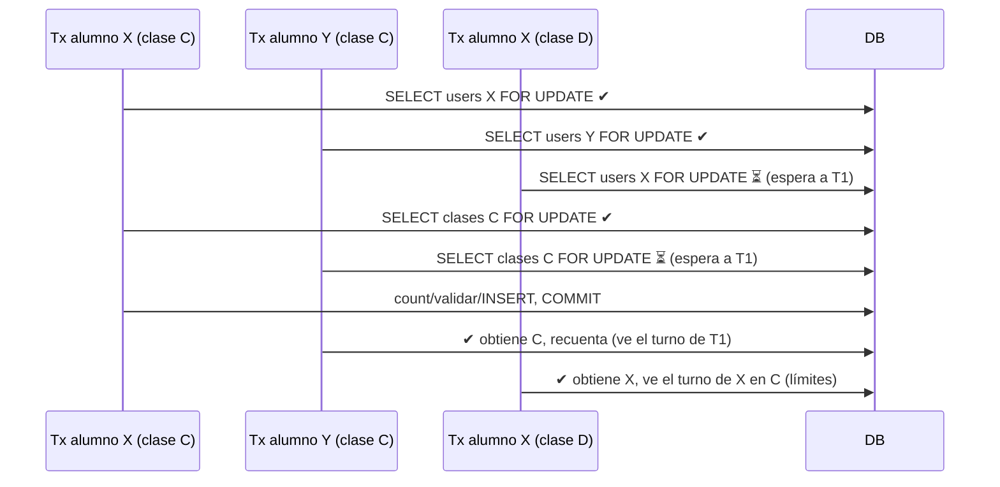
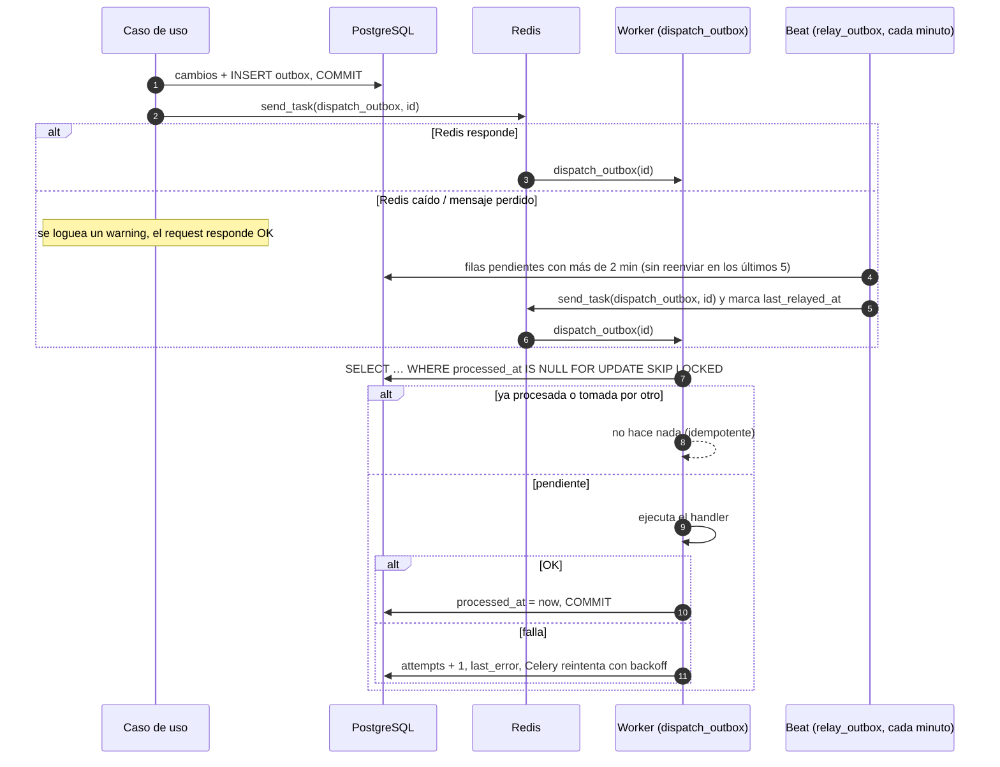
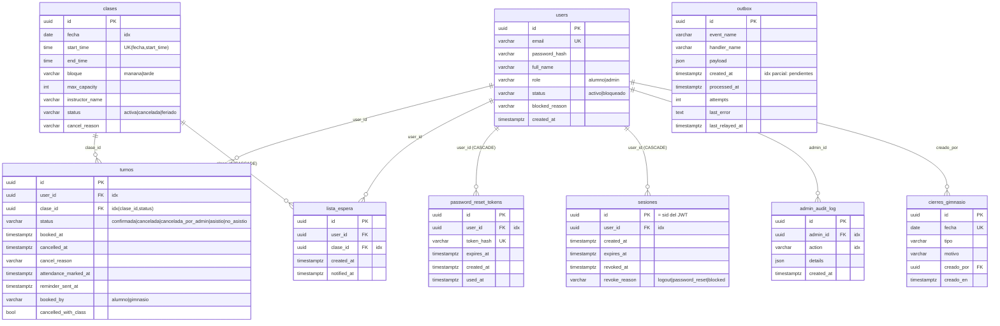

# Pilates Studio: Concurrencia, eventos y modelo de datos

> [Documentación técnica](TECH.md) · [Contextos `identity` y `scheduling`](identity-scheduling.md) · [Contextos `booking` y `notifications`](booking-notifications.md) · [Calendario de reservas y flujos principales](flujos.md) · **Concurrencia, eventos y modelo de datos**

---

## 11. Concurrencia y consistencia

### 11.1 Reservas simultáneas

Hay dos invariantes que proteger:

- **Cupo.** Nunca más de `max_capacity` lugares ocupados.
- **Límites diarios.** Como mucho 2 turnos por día y 1 por bloque por alumno, aunque el alumno mande dos requests en paralelo para clases distintas.

La solución es tomar locks pesimistas **siempre en el mismo orden**:



- **Lock del usuario.** Serializa las reservas del mismo alumno, y con eso protege los límites por día y por bloque.
- **Lock de la clase.** Serializa las reservas de la misma clase, y con eso protege el cupo.
- **Orden fijo (usuario → clase).** `BookClass` y `AdminBookClass` toman los locks en el mismo orden, así que no hay deadlocks entre ellos.
- **Aislamiento.** Postgres trabaja en READ COMMITTED: después de obtener el lock, el `COUNT` ve las filas que confirmaron las transacciones anteriores.
- **Última defensa.** La restricción única `uq_turnos_user_clase` impide dos filas para el mismo alumno y clase. Si se viola, el `IntegrityError` se convierte en `409 integrity_conflict`.
- **Cancelaciones y asistencia.** Toman el lock del turno (`turnos.get` usa `FOR UPDATE`). La cancelación también toma el de la clase.
- **Recordatorios.** Usan `FOR UPDATE SKIP LOCKED`.

Hay dos tests que lo verifican en `tests/application/test_concurrency.py`. Lanzan N hilos contra una clase de capacidad limitada y comprueban que nunca se supera el cupo:

- Sólo alumnos.
- Alumnos y recepción mezclados.

### 11.2 Consistencia inmediata y eventual

| Inmediata (misma transacción) | Eventual (evento → worker) |
|---|---|
| Cancelar los turnos de una clase cancelada o cerrada | Todos los emails |
| Vaciar la lista de espera de esa clase | Cancelar los turnos futuros de un usuario bloqueado |
| Auditoría de acciones admin | Asignación del lugar al primero de la lista de espera (o aviso a todos en la última hora) |
| Borrar la entrada de lista de espera al reservar | Aviso de clases reabiertas |

---

## 12. Eventos de dominio y tareas asíncronas

### 12.1 Catálogo de eventos

| Evento | Emisor | Campos | Handlers (nombre en el registry) |
|---|---|---|---|
| `UserRegistered` | `User.register` | `user_id` | — |
| `UserInvited` | `CreateUserByAdmin` | `user_id`, `set_password_url` | `notifications.bienvenida` |
| `UserBlocked` | `User.block` | `user_id`, `reason` | `booking.cancelar_turnos_bloqueado` |
| `PasswordResetRequested` | `RequestPasswordReset` | `user_id`, `reset_url` | `notifications.reset_password` |
| `TurnoReservado` | `Turno.reserve` / `rebook` | `turno_id`, `user_id`, `clase_id`, `desde_lista_espera` | `notifications.confirmacion` |
| `TurnoCancelado` | `Turno._cancel` | `turno_id`, `user_id`, `clase_id`, `por`, `motivo`, `con_clase` | `notifications.cancelacion_y_lista_espera` (aviso al alumno si canceló el gimnasio; conserva el nombre por compatibilidad con el outbox), `booking.promover_lista_espera` |
| `LugarLiberado` | `PromoteFromWaitlist` | `clase_id` | `notifications.lista_espera` |
| `TurnosHabilitados` | `GenerateDailyClasses`, `CreateCierres` | `fecha` | `notifications.apertura` |
| `DiaSinClases` | `GenerateDailyClasses`, `CreateCierres` | `fecha`, `motivo`, `proximo_dia_habil`, `excluir_user_ids` | `notifications.dia_sin_clases` |
| `ClasesReabiertas` | `ReactivateClase`, `DeleteCierre`, `GenerateDailyClasses` | `clase_ids` | `notifications.clases_reabiertas` |
| `CorreoSolicitado` | handlers de `notifications`, `SendClassReminders` | `to`, `subject`, `body` | `notifications.enviar_correo` |

Todos heredan `occurred_at`.

### 12.2 Celery

Configuración (`worker/celery_app.py`):

- **Serialización.** `timezone=TIMEZONE`, `enable_utc=False`, serialización JSON.
- **Confiabilidad.** `task_acks_late=True` y `task_reject_on_worker_lost=True`: si el worker muere a mitad de una tarea, la tarea se reencola.
- **Reparto.** `worker_prefetch_multiplier=1`.
- **Resultados.** `backend=None`: no se guardan los resultados de las tareas.
- **Publicación.** `task_publish_retry_policy` con 2 reintentos cortos: si Redis no responde, el request no se traba más de ~1 s. El evento ya está en el outbox.

| Tarea | Disparador | Reintentos | Qué hace |
|---|---|---|---|
| `pilates.dispatch_outbox(message_id)` | `CeleryOutboxNotifier` (tras el commit, o el relay) | `autoretry_for=Exception`, backoff exponencial, máx. 5 | Procesa **una** fila del outbox: un evento para un handler |
| `pilates.relay_outbox` | beat `outbox-relay`: cada minuto | — | Reenvía las filas pendientes cuyo aviso se perdió y purga las procesadas |
| `pilates.dispatch_event(event_name, handler_name, payload)` | — (formato anterior) | igual que `dispatch_outbox` | Sólo para mensajes encolados antes del deploy del outbox |
| `pilates.open_next_day` | beat `apertura-turnos`: `crontab(hour=HH, minute=MM, day_of_week="mon-fri")` | máx. 3 | `GenerateDailyClasses.execute(notify=True)` |
| `pilates.send_reminders` | beat `recordatorios`: cada 10 min | — | `SendClassReminders.execute()` |

Hay **una fila (y una tarea) por par (evento, handler)**. Así, si falla un handler (por ejemplo, el SMTP del aviso a la lista de espera), al reintentarlo no se reenvía la confirmación ni se repiten otros efectos.

### 12.3 Outbox transaccional



| Constante (`outbox.py`) | Valor | Para qué |
|---|---|---|
| `RELAY_GRACE` | 2 min | No reenviar lo que el aviso inmediato todavía está procesando |
| `RELAY_REQUEUE_AFTER` | 5 min | No reenviar mientras Celery sigue con sus reintentos |
| `MAX_ATTEMPTS` | 10 | Después, la fila queda pendiente para revisión manual y el relay loguea un error |
| `RELAY_BATCH` | 500 | Filas por pasada |
| `RETENTION` | 7 días | Se borran las filas procesadas más viejas |

Garantía: **al menos una vez**. Un handler se puede repetir si el proceso muere entre que termina y se marca `processed_at`; como cada fila de `notifications.enviar_correo` es un único correo, el peor caso es que **un** destinatario reciba un mail repetido.

Para ver qué quedó trabado:

```sql
SELECT event_name, handler_name, attempts, last_error, created_at
FROM outbox WHERE processed_at IS NULL ORDER BY created_at;
```

---

## 13. Modelo de datos

### 13.1 Diagrama entidad-relación



### 13.2 Restricciones e índices relevantes

| Restricción / índice | Propósito |
|---|---|
| `uq_clases_fecha_start_time` | Idempotencia de `ensure_daily_grid` (un slot por día y hora) |
| `uq_turnos_user_clase` | Un turno por alumno y clase; habilita `rebook` y es la última defensa contra carreras |
| `ix_turnos_clase_status (clase_id, status)` | `count_occupied`, conteos de grilla |
| `ix_turnos_user_id` | Mis turnos, límites diarios, bloqueo |
| `uq_lista_espera_user_clase` | Una entrada por alumno y clase |
| `cierres_gimnasio.fecha UNIQUE` | Un cierre por día |
| `ix_outbox_pending (created_at) WHERE processed_at IS NULL` | Índice parcial para el relay: sólo indexa las filas pendientes |
| `password_reset_tokens.token_hash UNIQUE` | Búsqueda por hash |
| Enums como `VARCHAR(32)` + `CHECK` | `native_enum=False, create_constraint=True`: agregar un valor requiere una migración del CHECK, no un `ALTER TYPE` |

### 13.3 Fechas y zonas horarias

- **Columnas de instante.** Todas son `timestamptz`.
- **Clases.** `clases.fecha` (`date`) y `start_time`/`end_time` (`time`, sin zona) están en **hora local del estudio** (`TIMEZONE`). El dominio arma `starts_at` combinando esos valores con la tz del `Clock`.
- **Comparaciones en SQL.** Las consultas por rango (recordatorios, turnos futuros) convierten `now` a hora local antes de comparar con `fecha` + `start_time`.

### 13.4 Migraciones (Alembic)

| Revisión | Archivo | Cambios |
|---|---|---|
| `04edcad12a0b` | `20261015_04edcad12a0b_initial_schema.py` | Esquema inicial (7 tablas) |
| `7c1e4b9a2d3f` | `20261019_7c1e4b9a2d3f_turnos_booked_by.py` | `turnos.booked_by` (`alumno` por defecto) |
| `b5d2f8e1c4a7` | `20261019_b5d2f8e1c4a7_turnos_cancelled_with_class.py` | `turnos.cancelled_with_class`. Backfill: `true` para los `cancelada_por_admin` cuyo motivo no es "Cuenta suspendida" |
| `a8c4e2f6b1d9` | `20261020_a8c4e2f6b1d9_sesiones.py` | Tabla `sesiones` (un registro por login) |
| `e3a9c7d1f5b2` | `20261020_e3a9c7d1f5b2_outbox.py` | Tabla `outbox` + índice parcial `ix_outbox_pending (created_at) WHERE processed_at IS NULL` |

La API ejecuta `alembic upgrade head` cada vez que arranca. Para crear una revisión nueva:

```bash
.venv/bin/alembic revision --autogenerate -m "descripcion"   # con DATABASE_URL apuntando a una base migrada
```

El nombre de archivo sigue `file_template = YYYYMMDD_<rev>_<slug>`.
