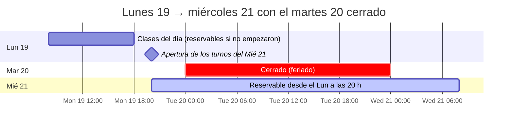
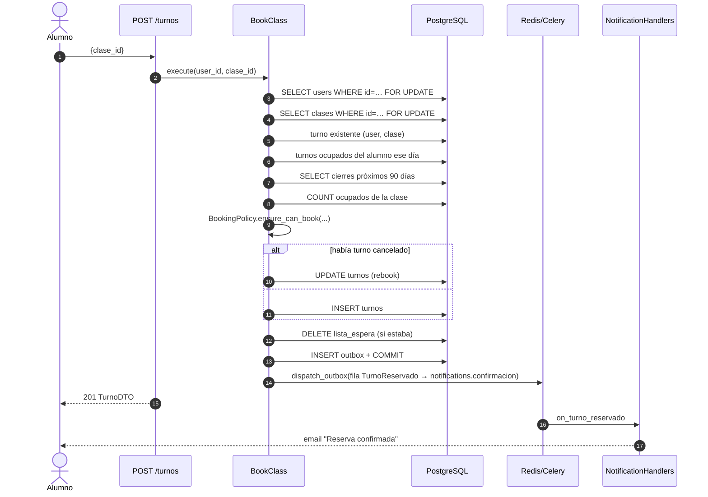
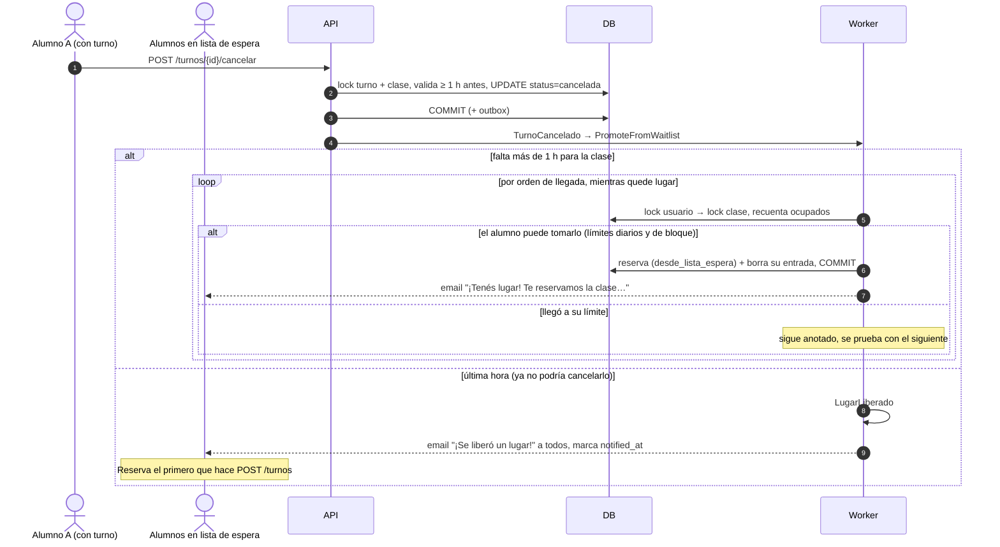
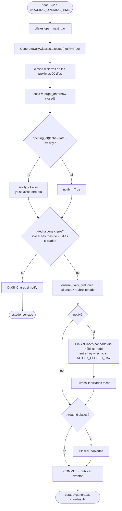
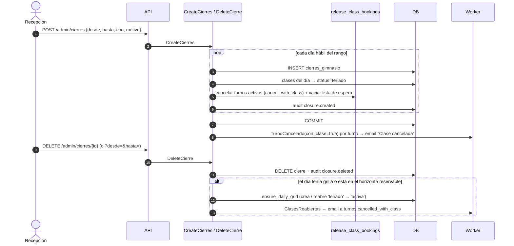
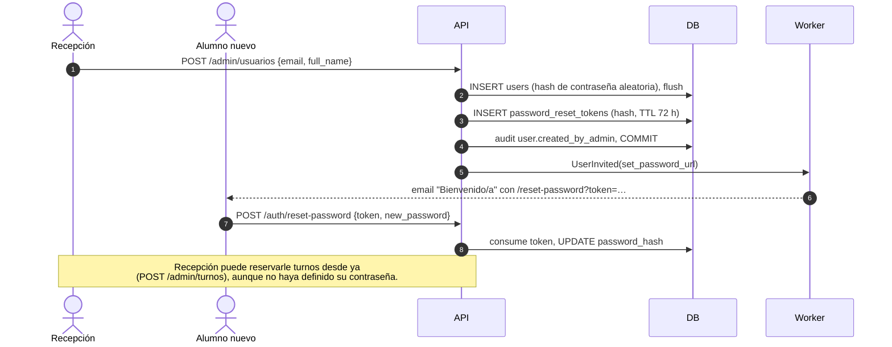

# Pilates Studio: Calendario de reservas y flujos principales

> [Documentación técnica](TECH.md) · [Contextos `identity` y `scheduling`](identity-scheduling.md) · [Contextos `booking` y `notifications`](booking-notifications.md) · **Calendario de reservas y flujos principales** · [Concurrencia, eventos y modelo de datos](consistencia-eventos-datos.md)

---

## 9. Calendario de reservas (horizonte y apertura)

`BookingCalendar` (en `scheduling/domain/calendar.py`) es un servicio de dominio sin estado. Recibe `now` y el conjunto `closed`, que son las fechas con cierre cargado en los próximos 90 días según `closed_dates_from(uow, hoy)`.

| Función | Definición |
|---|---|
| `next_open_weekday(d, closed)` | Primer día hábil > `d` que no está en `closed` (tope 90 saltos) |
| `previous_open_weekday(d, closed)` | Último día hábil < `d` que no está en `closed` |
| `target_date(now, closed)` | `next_open_weekday(hoy, closed)`: el día que se puede reservar "para mañana" |
| `opening_at(fecha, now, closed)` | `previous_open_weekday(fecha) @ BOOKING_OPENING_TIME` |
| `is_bookable_date(fecha, now, closed)` | Hábil **y** (`fecha == hoy` y `allow_same_day`) **o** (`fecha == target` y `now ≥ opening_at`) |
| `bookable_dates(now, closed)` | `[hoy?] + [días hábiles cerrados intermedios] + [target]`, lo que muestra la pantalla "Reservar" |

### 9.1 Ejemplos

Sin cierres:

| Ahora | Fechas mostradas | Estado del target |
|---|---|---|
| Lun 18:40 | Lun (hoy), Mar | Mar `pendiente_apertura` (apertura Lun 20:00) |
| Lun 20:05 | Lun, Mar | Mar `abierta` |
| Vie 20:05 | Vie, Lun | Lun `abierta` |
| Sáb 10:00 | Lun | Lun `abierta` (abrió el Vie 20:00); el sábado no es hábil |

Con el **martes 20 cerrado** (feriado), el caso que se vio en producción el 19/10/2026:



- A las 18:40 del lunes, la pantalla muestra:
  - Lun 19: `abierta`.
  - Mar 20: `cerrado`, con próximo día hábil Mié 21.
  - Mié 21: `pendiente_apertura`, con apertura Lun 20:00.
- A las 20:00 corre el job:
  - Genera la grilla del 21 (idempotente).
  - Emite `DiaSinClases(20)` y `TurnosHabilitados(21)`.
  - El 21 pasa a `abierta`.
- El martes 20 a las 20:00 el job vuelve a correr, porque beat corre de lunes a viernes:
  - `target_date` sigue siendo el 21.
  - Su `opening_at` fue el lunes, no hoy, así que **no reenvía** los emails.
  - Sólo garantiza que la grilla exista.

---

## 10. Flujos principales

### 10.1 Reserva de un alumno



### 10.2 Cancelación y lista de espera



- **Por qué en el worker y una transacción por candidato.** Cada intento toma los locks en el mismo orden que `BookClass` (usuario → clase) y vuelve a contar los lugares, así que una reserva directa que llegue al mismo tiempo no puede superar el cupo (`test_waitlist_promotion_racing_direct_bookings_never_exceeds_capacity`).
- **Si nadie puede tomarlo** (todos llegaron a su límite), el lugar queda libre para cualquiera y los anotados siguen en la lista.
- **El turno asignado es uno más:** se puede cancelar hasta 1 h antes, recibe recordatorio y cuenta para los límites. `booked_by` queda `alumno`, porque lo pidió él al anotarse.
- **Disparadores:** cualquier `TurnoCancelado` con la clase activa: cancelación del alumno, del admin (turno puntual) o por bloqueo de cuenta. Cancelar o cerrar la clase entera vacía la lista de espera.

### 10.3 Apertura nocturna (job de las 20:00)



Resultado del log de Celery el 19/10/2026 a las 20:00:

```
Task pilates.open_next_day[…] succeeded in 0.43s: {'fecha': '2026-10-21', 'estado': 'generada', 'creadas': 0}
```

Luego se ejecutaron dos despachos de eventos (`dispatch_event`, el formato previo al outbox): `DiaSinClases(20)` y `TurnosHabilitados(21)`. Mailpit recibió 4 + 4 correos, uno de cada tipo por alumno activo.

### 10.4 Carga y eliminación de cierres



¿Quién se entera de un cierre?

| Momento en que se carga | Alumnos con turno ese día | Resto de los alumnos |
|---|---|---|
| Antes de la apertura del día (ej. el lunes 18:00 cierra el martes) | "Clase cancelada: …" (sólo si un admin les había reservado) | "Sin clases el …" en el job de las 20:00 |
| Con el día ya habilitado (ej. el lunes 21:00 cierra el martes, o cierra hoy) | "Clase cancelada: …" con el motivo | "Sin clases el …" en el momento |

En el segundo caso el cierre puede adelantar el próximo día reservable: si el lunes 21:00 se cierra el martes, el miércoles queda habilitado de inmediato (su apertura pasa a ser el lunes 20:00). Se genera su grilla y se envía "Ya podés reservar tus turnos del miércoles…", porque el job del martes no lo va a anunciar.

Las reservas canceladas **no se restauran** al reabrir, porque el lugar pudo haberlo tomado otro alumno. Lo que se hace es avisar a los afectados para que vuelvan a reservar.

### 10.5 Alta de alumno por recepción



### 10.6 Bloqueo de usuario

1. `POST /admin/usuarios/{id}/bloquear` pasa el estado a `bloqueado`, emite `UserBlocked` y registra el audit `user.blocked`.
2. El worker ejecuta `CancelUpcomingBookingsOfBlockedUser`: aplica `cancel_by_gym("Cuenta suspendida")` a cada turno confirmado cuya clase empieza desde ahora.
3. Cada cancelación emite `TurnoCancelado`, que avisa al alumno y le pasa el lugar al primero de la lista de espera.
4. A partir de ahí, cualquier request con su token responde `403 user_blocked`, porque `GetCurrentUser` verifica el estado.
