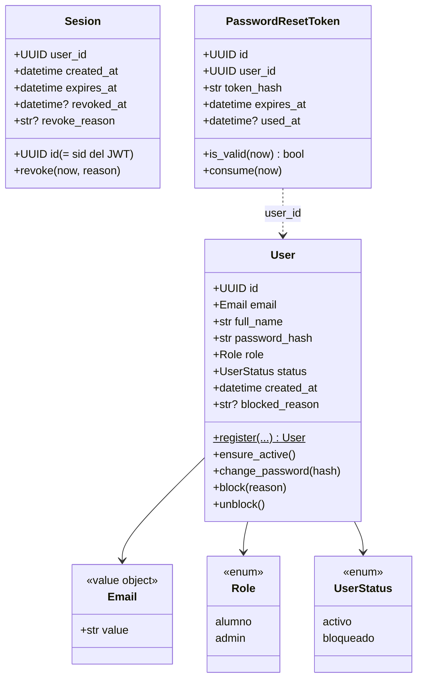
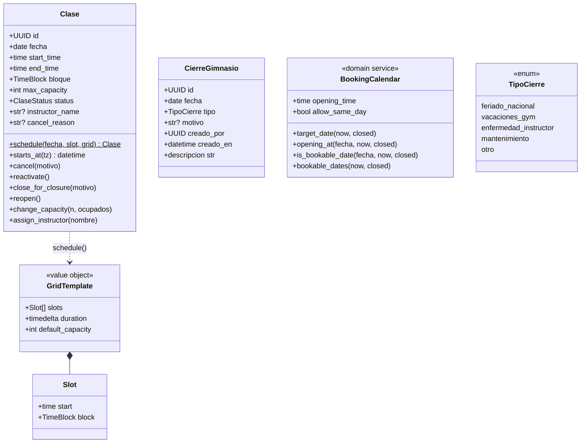
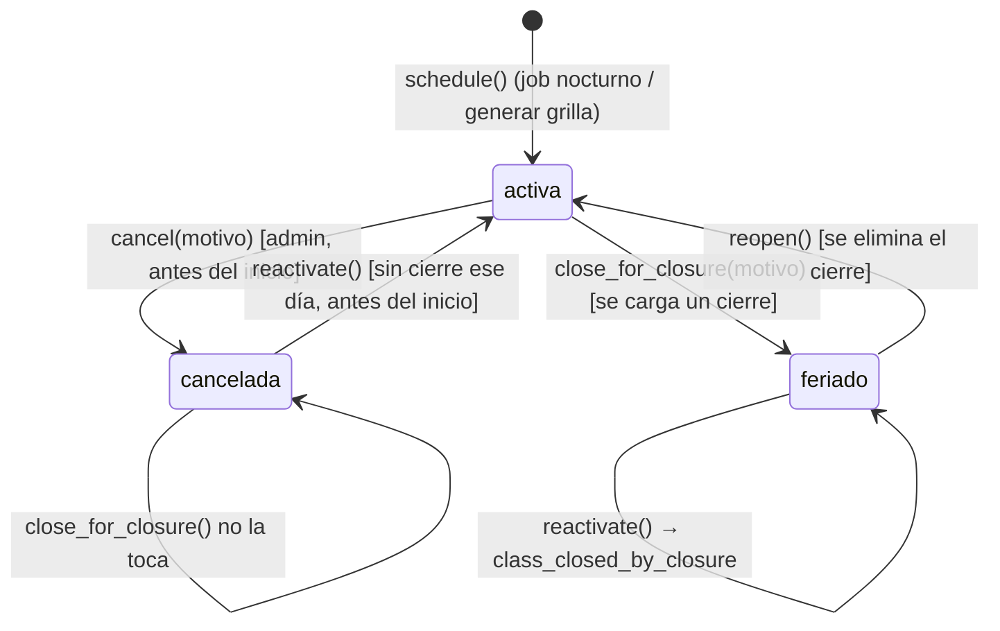

# Pilates Studio: Contextos `identity` y `scheduling`

> [Documentación técnica](TECH.md) · **Contextos `identity` y `scheduling`** · [Contextos `booking` y `notifications`](booking-notifications.md) · [Calendario de reservas y flujos principales](flujos.md) · [Concurrencia, eventos y modelo de datos](consistencia-eventos-datos.md)

---

## 5. Contexto `identity`

### 5.1 Modelo

Reglas:

- **Email.** Se valida con una regex simple y se normaliza (`invalid_email`). En HTTP, además, el registro valida con `EmailStr`, que rechaza TLDs reservados como `.local`.
- **Nombre.** Es obligatorio (`invalid_name`).
- **Contraseña.** Mínimo 8 caracteres (`weak_password`). bcrypt sólo considera los primeros 72 bytes.
- **Bloqueo.** No se puede bloquear a un admin (`cannot_block_admin`). Bloquear a alguien que ya está bloqueado no hace nada. El bloqueo emite `UserBlocked`.
- **Usuario bloqueado.**
  - `ensure_active()` lanza `PermissionDenied("user_blocked")`.
  - No puede loguearse, ni usar un token emitido antes del bloqueo, ni reservar.
- **Token de reset.**
  - Es de un solo uso y tiene vencimiento (`invalid_reset_token`).
  - En la base sólo se guarda el **hash**; el token en claro viaja únicamente en el email.

### 5.2 Casos de uso

| Caso de uso | Qué hace | Eventos / auditoría |
|---|---|---|
| `RegisterUser` | Alta pública (rol alumno; `cli create-admin` lo usa con rol admin). `email_taken` si existe | `UserRegistered` (sin handlers) |
| `CreateUserByAdmin` | Alta por recepción: contraseña aleatoria (nadie la conoce) + token con TTL `INVITE_TTL_HOURS` (72 h) | `UserInvited` → email de bienvenida con link a `/reset-password?token=…`; audit `user.created_by_admin` |
| `Login` | Verifica bcrypt y estado; crea una `Sesion` (un dispositivo) y emite un JWT con su `sid`. Purga las sesiones vencidas de ese usuario. Mensaje genérico para no revelar si el email existe | — |
| `Logout` | Revoca la sesión de este dispositivo (`revoke_reason=logout`); las de otros dispositivos siguen | — |
| `GetCurrentUser` | Usado por `deps.current_user`: sesión válida y de ese usuario (`session_revoked`) y usuario activo | — |
| `RequestPasswordReset` | Invalida tokens previos del usuario y crea uno nuevo (TTL `PASSWORD_RESET_TTL_MINUTES`). **Nunca** revela si el email existe; ignora bloqueados | `PasswordResetRequested` → email |
| `ResetPassword` | Consume token (`SELECT … FOR UPDATE`), cambia hash y **revoca todas las sesiones** del usuario | — |
| `BlockUser` / `UnblockUser` | Con lock del usuario. Bloquear revoca todas sus sesiones; desbloquear no las reabre (tiene que volver a ingresar) | `UserBlocked` → cancela turnos futuros; audit `user.blocked` / `user.unblocked` |
| `ListUsers` | Búsqueda por nombre/email (`ILIKE`), filtro por estado, paginado (máx. 200). Incluye `asistencias`, `ausencias`, `reservas_activas` | — |

### 5.3 Adaptadores de seguridad

- **`BcryptPasswordHasher`.** Usa `bcrypt.gensalt()` con el costo por defecto (12). Es la operación más cara del sistema (ver [§19.2](TECH.md#192-prueba-de-carga-locust)).
- **`JwtTokenService`.** HS256. Claims: `sub` (user id), `role`, `sid` (id de la sesión), `iat` y `exp`. Duración: `JWT_EXPIRES_MINUTES`, por defecto 720 (12 h). Un token sin `sid` (emitido antes de las sesiones revocables) se rechaza con `invalid_token`.
- **`Sha256SecretTokenGenerator`.** `secrets.token_urlsafe(32)` y su hash SHA-256.

---

## 6. Contexto `scheduling`

### 6.1 Modelo

### 6.2 Estados de una clase

- **Clase `cancelada` y cierres.** Una clase cancelada a mano no cambia cuando se carga un cierre. Por eso, al eliminar el cierre sigue cancelada: `reopen()` sólo reabre las que están en `feriado`.
- **Capacidad.** `change_capacity` no permite bajarla por debajo de los lugares ocupados (`capacity_below_bookings`) ni dejarla en menos de 1.

### 6.3 Casos de uso

| Caso de uso | Detalle |
|---|---|
| `GenerateDailyClasses.execute(fecha=None, notify=False)` | Corazón del job nocturno. Ver [§10.3](flujos.md#103-apertura-nocturna-job-de-las-2000). Con `fecha` explícita (admin "Generar grilla") genera ese día. Valida `not_a_weekday` y `date_in_past`. Si la fecha tiene cierre devuelve `estado="cerrado"` |
| `ensure_daily_grid(uow, grid, fecha)` | Idempotente: crea los slots faltantes (único `(fecha, start_time)`) y reabre los `feriado` cuyo cierre ya no existe. Devuelve `(creadas, ids_reabiertos)` |
| `ListClassesForDate` | Read model admin: clase + `reservados` + `lista_espera` |
| `UpdateClase` | Capacidad y/o instructor, con lock de la clase. Audit `class.updated` |
| `CancelClase` | Sólo antes del inicio (`class_already_started`). `release_class_bookings` cancela los turnos en la misma transacción y vacía la lista de espera. Audit `class.cancelled` |
| `ReactivateClase` | Sólo antes del inicio y si el día no tiene cierre (`day_closed`). Emite `ClasesReabiertas` |
| `CreateCierres(desde, hasta?, tipo, motivo)` | Rango ≤ 366 días, sin pasado, sólo días hábiles (`invalid_range`). Falla entero si algún día ya tiene cierre (`closure_exists`). Por día: crea cierre, pasa clases a `feriado`, cancela turnos. Audit `closure.created` por día. Si el día **ya estaba habilitado** (hoy, o la apertura nocturna ya pasó), avisa `DiaSinClases` a los demás alumnos en el momento; y si el cierre adelanta el próximo día reservable, genera su grilla y avisa `TurnosHabilitados` (ver [§10.4](flujos.md#104-carga-y-eliminación-de-cierres)) |
| `UpdateCierre` | Cambia tipo/motivo. Audit `closure.updated` |
| `DeleteCierre.execute(cierre_id)` / `.execute_range(desde, hasta)` | Elimina y reabre. Si el día ya tenía grilla **o** queda dentro del horizonte reservable, llama a `ensure_daily_grid`. Emite `ClasesReabiertas` con los ids reabiertos. Audit `closure.deleted` |
| `ListCierres`, `GetCalendar` (admin, ≤ 92 días) | Read models |
| `GetStudentCalendar` | Hoy + 30 días por defecto. Por día: `hay_clases` y, si hay cierre, `tipo_cierre`, `motivo`, `etiqueta` legible ("Feriado - Sin clases"). No expone quién cargó el cierre |
